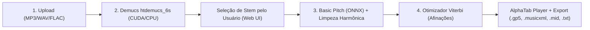

# EscriTab — Especificação de Design (Suno / Áudio → Stems → MIDI → Tablatura)

**Data:** 2026-11-14  
**Projeto:** EscriTab (`d:\dev\github\music\escritab`)  
**Objetivo:** Aplicação web local em Python para extrair stems de músicas geradas por IA (como Suno), permitir que o usuário ouça e selecione a pista de guitarra, transcreva para MIDI com limpeza de ruído harmônico/distorção (foco em guitarra/Metal), otimize as posições no braço da guitarra para diversas afinações e exiba a tablatura em um player interativo (AlphaTab.js) com exportação para `.gp5`, `.musicxml`, `.mid` e `.txt` (ASCII).

---

## 1. Visão Geral da Arquitetura

O sistema utiliza uma arquitetura cliente-servidor local:
- **Backend:** Python 3.11 + **FastAPI**, gerenciando sessões de trabalho (`jobs`) persistidas em disco (`workspace/jobs/<job_id>/`) para que cada etapa do pipeline possa ser reexecutada independentemente sem retrabalho das etapas anteriores.
- **Pipeline de IA e Processamento Musical:**
  1. **Separação de Fontes (`Demucs`):** Modelo padrão `htdemucs_6s` (6 stems: `guitar`, `other`, `bass`, `drums`, `vocals`, `piano`) acelerado via GPU NVIDIA CUDA (PyTorch), com fallback automático para CPU.
  2. **Pré-processamento e Limpeza de Áudio (`audio_cleaner`):** Filtro passa-faixa opcional para guitarra elétrica (80 Hz a 5000 Hz), noise gate e estimativa de BPM via `librosa`.
  3. **Transcrição Áudio → MIDI (`Basic Pitch` via ONNX Runtime + Pós-processador Metal):** Converte a pista selecionada em eventos MIDI com controles ajustáveis de limiar de ataque (*onset threshold*), limiar de sustentação (*frame threshold*), duração mínima de nota, supressão de harmônicos espúrios (oitavas e quintas fantasmas geradas por distorção de alto ganho) e quantização rítmica opcional.
  4. **Otimização de Digitação no Braço (`fretboard` — Algoritmo de Viterbi):** Mapeia notas e acordes do MIDI para pares `(corda, casa)` respeitando a afinação selecionada, limites anatômicos da mão e continuidade de posição ao longo do braço.
  5. **Exportadores (`exporters`):** Gera arquivos **MusicXML (`.musicxml`)**, **Guitar Pro 5 (`.gp5`)**, **Tablatura ASCII (`.txt`)** e **MIDI Limpo (`.mid`)**.
- **Frontend:** Aplicação web single-page (`HTML5 + CSS3 + JS Vanilla`) servida pelo próprio FastAPI, integrando players de áudio nativos para audição das stems e o **AlphaTab.js** para reprodução interativa da tablatura com cursor sincronizado, controle de velocidade (`0.25x` a `1.25x`), metrônomo e loop de compassos.



---

## 2. Estrutura de Diretórios e Módulos

```text
escritab/
├── app/
│   ├── __init__.py
│   ├── main.py                 # Servidor FastAPI, rotas REST e arquivos estáticos
│   ├── models.py               # Schemas Pydantic de request/response e presets de afinação
│   ├── job_manager.py          # Persistência de metadados (job.json) e arquivos em workspace/jobs/
│   ├── pipeline/
│   │   ├── __init__.py
│   │   ├── stem_separator.py   # Execução do Demucs (htdemucs_6s / htdemucs) com gerenciamento de VRAM
│   │   ├── audio_cleaner.py    # Filtro passa-faixa (scipy), noise gate, mixagem de stems e detecção de BPM
│   │   ├── midi_transcriber.py # Inferência Basic Pitch (ONNX) + filtros anti-ruído harmônico e quantização
│   │   ├── fretboard.py        # Catálogo de afinações e solver Viterbi para alocação de cordas/casas
│   │   └── exporters.py        # Geração de .musicxml, .gp5 (via pyguitarpro) e .txt (ASCII tab)
│   └── static/
│       ├── index.html          # Interface principal (4 etapas + visualizador AlphaTab)
│       ├── styles.css          # Tema escuro focado em leitura musical e controles de estúdio
│       └── app.js              # Orquestração da UI, players de stems e API do AlphaTab.js
├── workspace/
│   └── jobs/                   # Armazenamento local das sessões processadas
├── tests/
│   ├── test_audio_cleaner.py
│   ├── test_midi_transcriber.py
│   ├── test_fretboard.py
│   ├── test_exporters.py
│   └── test_api.py
├── requirements.txt
└── run.py                      # Ponto de entrada para iniciar o servidor local
```

---

## 3. Especificação Detalhada dos Componentes

### 3.1. Gerenciador de Sessões (`job_manager.py`)
Cada upload cria uma pasta `workspace/jobs/<job_id>/` contendo um arquivo `job.json` com:
- `job_id`, `created_at`, `original_filename`, `is_isolated_stem`
- `detected_bpm`: BPM estimado automaticamente (editável pelo usuário)
- `stems`: Dicionário mapeando nome da stem (`guitar`, `other`, `bass`, `drums`, `vocals`, `piano`) para o caminho do `.wav`
- `selected_stem`: Nome da stem escolhida pelo usuário (ou `"guitar+other"` para mixagem das duas pistas)
- `transcription_params`: Parâmetros usados na última geração de MIDI
- `tab_params`: Afinação, número de casas e região preferencial do braço usados na última geração de tablatura
- `artifacts`: Caminhos para `guitar_clean.mid`, `tab.musicxml`, `tab.gp5` e `tab.txt`

### 3.2. Separação de Stems (`stem_separator.py`)
- Utiliza `demucs.separate` programaticamente ou via subprocesso isolado no ambiente Python.
- Modelo padrão: `htdemucs_6s` (isola `guitar` dedicada). Permite selecionar `htdemucs` (4 stems) caso desejado.
- **Gerenciamento de GPU:** Detecta `torch.cuda.is_available()`. Em GPUs com 6 GB de VRAM (como a RTX 3050), utiliza segmentação segura (`segment=7`) e executa `torch.cuda.empty_cache()` ao finalizar.
- **Atalho Stem Isolada:** Se o usuário marcar `is_isolated_stem=True` no upload, o arquivo enviado é copiado diretamente como `guitar.wav`, pulando o Demucs.

### 3.3. Pré-processamento e Mixagem de Áudio (`audio_cleaner.py`)
- Permite usar uma única stem (ex: `guitar.wav`) ou somar duas stems (ex: `guitar.wav` + `other.wav` normalizados, útil quando o Suno divide guitarra base e guitarra solo entre `guitar` e `other`).
- **Filtro Passa-Faixa (Band-Pass Butterworth de 4ª ordem):** Configurável (padrão ativo: `75 Hz` a `5500 Hz`) para remover sub-graves de bumbo/baixo vazados e chiados agudos de pratos/sintetizadores.
- **Noise Gate RMS:** Silencia trechos cujo envelope RMS fique abaixo de um limiar configurável (ex: `-45 dB`), evitando que caudas de reverb/delay com distorção virem notas falsas no MIDI.
- **Detecção de BPM:** Usa `librosa.beat.beat_track` no áudio original para sugerir o BPM inicial (padrão `120` caso não detectável).

### 3.4. Transcrição MIDI e Limpeza Harmônica (`midi_transcriber.py`)
- Executa a inferência do **Basic Pitch** sobre o áudio pré-processado:
  - `onset_threshold` (padrão: `0.5`, ajustável de `0.2` a `0.85` — valores maiores reduzem ruído de distorção).
  - `frame_threshold` (padrão: `0.3`, ajustável de `0.15` a `0.7`).
  - `minimum_note_length_ms` (padrão: `60 ms`, ajustável de `20 ms` a `200 ms`).
  - `minimum_frequency` / `maximum_frequency`: limitado automaticamente à tessitura da afinação escolhida (da nota da corda mais grave aberta até a casa 24 da corda mais aguda).
- **Filtro de Supressão de Harmônicos Espúrios (`harmonic_suppression`):**
  - Em guitarras com alto ganho (Metal/Suno), uma nota fundamental $f_0$ (MIDI pitch $p$) frequentemente dispara falsos positivos simultâneos em $p + 12$ (2º harmônico / oitava) e $p + 19$ (3º harmônico / oitava + quinta).
  - Quando `suppress_harmonics=True`, para cada grupo de notas com início próximo ($\Delta t \le 35\text{ ms}$), se houver uma nota em $p + 12$ ou $p + 19$ cuja velocidade (amplitude) seja inferior a uma razão configurável da fundamental (ex: `< 75%` da velocidade da nota grave $p$), o harmônico espúrio é removido.
- **Limitação de Polifonia Simultânea:** Garante no máximo $N$ notas simultâneas ($N = \text{número de cordas da guitarra}$, mantendo as de maior velocidade).
- **Quantização Opcional:** Quando ativada (`quantize_grid` = `1/16` ou `1/32`), alinha onsets e durações à grade temporal baseada no BPM definido.

### 3.5. Otimização de Posição no Braço (`fretboard.py`)
- **Catálogo de Afinações Suportadas (da corda mais grave para a mais aguda, em números MIDI):**
  - `standard_e`: **Standard E (6 cordas)** — `E2 (40), A2 (45), D3 (50), G3 (55), B3 (59), E4 (64)`
  - `drop_d`: **Drop D (6 cordas)** — `D2 (38), A2 (45), D3 (50), G3 (55), B3 (59), E4 (64)`
  - `eb_standard`: **Eb / Meio Tom Abaixo (6 cordas)** — `Eb2 (39), Ab2 (44), Db3 (49), Gb3 (54), Bb3 (58), Eb4 (63)`
  - `d_standard`: **D Standard (6 cordas)** — `D2 (38), G2 (43), C3 (48), F3 (53), A3 (57), D4 (62)`
  - `drop_c`: **Drop C (6 cordas)** — `C2 (36), G2 (43), C3 (48), F3 (53), A3 (57), D4 (62)`
  - `drop_b`: **Drop B (6 cordas)** — `B1 (35), F#2 (42), B2 (47), E3 (52), G#3 (56), C#4 (61)`
  - `seven_standard`: **7 Cordas Standard (BEADGBE)** — `B1 (35), E2 (40), A2 (45), D3 (50), G3 (55), B3 (59), E4 (64)`
  - `seven_drop_a`: **7 Cordas Drop A (AEADGBE)** — `A1 (33), E2 (40), A2 (45), D3 (50), G3 (55), B3 (59), E4 (64)`
- **Algoritmo de Viterbi sobre Fatias de Tempo (Time Slices / Eventos):**
  1. As notas do MIDI são agrupadas em eventos simultâneos (notas cujos onsets estão dentro de uma janela de `30 ms` formam um acorde/evento único).
  2. Para cada evento $t$ com notas $P_t = \{p_1, p_2, \dots, p_k\}$, geram-se todos os estados candidatos válidos $S_t = \{(s_1, f_1), \dots, (s_k, f_k)\}$ tais que:
     - Todas as cordas $s_i$ sejam distintas.
     - $0 \le f_i \le \text{max\_frets}$ (padrão `24`).
     - A abertura máxima entre casas pressionadas ($\max(f_i > 0) - \min(f_i > 0)$) seja $\le 5$ casas.
     - Caso um acorde denso do MIDI não possua digitação anatomicamente possível com todas as notas, o algoritmo descarta iterativamente a nota de menor velocidade até existir ao menos uma digitação válida.
  3. **Custo Interno do Estado ($C_{\text{state}}$):**
     - Penaliza aberturas largas de dedos (span interno).
     - Aplica leve preferência pela região escolhida pelo usuário (`low`: casas 0–7, `mid`: casas 3–12, `high`: casas 7–19, ou `auto`).
     - Em `Drop D` / `Drop C` / `Drop A`, bonifica power chords nas 3 cordas mais graves usando pestana na mesma casa.
  4. **Custo de Transição ($C_{\text{trans}}(S_{t-1}, S_t)$):**
     - Distância entre o centro de gravidade da mão (média das casas $> 0$) de $S_{t-1}$ para $S_t$, ponderada pelo inverso do intervalo de tempo $\Delta t$ (saltos grandes em pouco tempo têm penalidade alta).
     - Penalidade leve por troca excessiva de corda em notas melódicas consecutivas.
  5. O caminho ótimo global é recuperado por *backtracking*, produzindo a sequência final de eventos tabulados.

### 3.6. Exportadores (`exporters.py`)
- **MusicXML (`.musicxml`):** Gera XML estruturado com `<staff-details>` definindo o número de cordas e a afinação (`<staff-tuning>`), além das tags técnicas `<technical><string>` e `<fret>` em cada nota para renderização perfeita de tablatura no **AlphaTab.js**, Guitar Pro, TuxGuitar e MuseScore.
- **Guitar Pro 5 (`.gp5`):** Utiliza a biblioteca `pyguitarpro` para construir o objeto `Song` com a quantidade correta de cordas, afinação da pista, andamento (BPM), compassos e notas com suas respectivas cordas e casas, salvando em `.gp5`.
- **Tablatura ASCII (`.txt`):** Renderiza linhas horizontais representando cada corda (nomeadas conforme a afinação) quebradas em sistemas legíveis de largura fixa (ex: 80 caracteres por linha) com indicação de compassos.

---

## 4. Especificação dos Endpoints da API REST

| Método | Rota | Descrição |
| :--- | :--- | :--- |
| `GET` | `/api/tunings` | Lista todas as afinações suportadas e suas notas/cordas. |
| `GET` | `/api/jobs` | Lista os jobs já criados em `workspace/jobs/` para retomada rápida. |
| `POST` | `/api/jobs/upload` | Recebe o arquivo de áudio (`multipart/form-data`) e `is_isolated_stem: bool`. Cria o job e detecta o BPM inicial. |
| `POST` | `/api/jobs/{job_id}/separate` | Executa o Demucs (`model="htdemucs_6s"`) e retorna a URL de cada stem extraída. |
| `POST` | `/api/jobs/{job_id}/transcribe` | Recebe a stem selecionada (`guitar`, `other`, `guitar+other`, etc.) e parâmetros de limpeza MIDI; gera `guitar_clean.mid` e retorna estatísticas (total de notas, faixa de notas). |
| `POST` | `/api/jobs/{job_id}/tab` | Recebe `tuning`, `max_frets`, `fret_preference`, `bpm`; roda o Viterbi no MIDI atual e gera `.musicxml`, `.gp5` e `.txt`. |
| `GET` | `/api/jobs/{job_id}/files/{filename}` | Serve os arquivos de áudio (`.wav`), MIDI (`.mid`) e tablaturas (`.musicxml`, `.gp5`, `.txt`). |

---

## 5. Tratamento de Erros e Casos Extremos

1. **Estouro de VRAM / Falha CUDA:** Se o Demucs falhar na GPU por falta de memória, tenta novamente com `segment` reduzido e, em último caso, faz fallback transparente para CPU informando o usuário.
2. **Nenhuma Nota Detectada no MIDI:** Se os filtros estiverem restritivos demais e resultarem em 0 notas, a API retorna HTTP `422` com mensagem amigável orientando reduzir o *Onset Threshold* ou verificar se a stem escolhida possui som.
3. **Notas Fora do Alcance da Guitarra:** Notas abaixo da corda mais grave da afinação escolhida são transpostas em oitavas acima até caberem no braço (ou descartadas se configuradas como ruído sub-grave), retornando a contagem de notas ajustadas nos metadados da resposta.

---

## 6. Estratégia de Testes

- `tests/test_audio_cleaner.py`: Testa filtro passa-faixa, noise gate e soma de stems com sinais senoidais sintéticos.
- `tests/test_midi_transcriber.py`: Testa o pós-processador de MIDI garantindo que notas fantasmas curtas e harmônicos espúrios ($+12$ e $+19$ semitons de baixa velocidade) sejam filtrados e que a quantização funcione corretamente.
- `tests/test_fretboard.py`: Testa o algoritmo de Viterbi em afinações de 6 e 7 cordas (Standard E, Drop D, Drop C, 7-String), verificando que acordes nunca aloquem duas notas na mesma corda e que escalas mantenham posição ergonômica no braço.
- `tests/test_exporters.py`: Valida a geração de arquivos `.musicxml`, `.gp5` e `.txt` a partir de uma sequência de eventos tabulados, confirmando que são parseáveis sem erro.
- `tests/test_api.py`: Testa o ciclo completo dos endpoints FastAPI (`upload` → `transcribe` → `tab` → `files`) usando `TestClient`.
